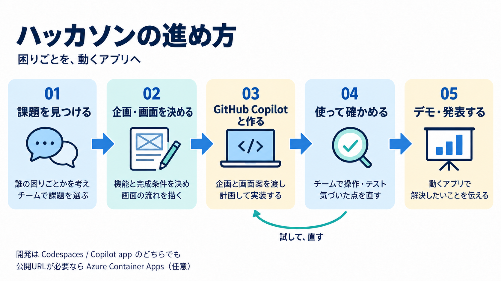

# 学生ハッカソン：GitHub Copilotと作る

アイデアを、確かめられるアプリへ。

学生チームが目的と完成条件を決め、GitHub Copilotと一緒に実装・テスト・改善するための教材です。**CodespacesのCopilot ChatとGitHub Copilot appのどちらでも進められます。**

初めて読むときは、下の[企画から発表まで](#企画から発表まで)で現在地を確認します。企画済みならコース選択へ、チーム用リポジトリも作成済みなら[環境を選ぶ](#環境を選ぶ)へ進んでください。**開発中は、選んだ環境ガイドを本線にして、案内された共通資料を読んだら元の手順へ戻ります。**

途中から再開する場合は、[保存済みの作業から続ける](docs/common/build-loop.md#resume-work)へ進みます。企画・Plan・環境の準備を毎回やり直す必要はありません。

## 自分たちに合う始め方を選ぶ

| コース | ブランチ | 向いているチーム |
| --- | --- | --- |
| 構成から相談して作る | `main`（このページ） | 企画に合わせて、使う技術やアプリの構成をCopilotと決めたい |
| 初心者向けスターター | `codex/beginner-starter` | 起動・テストの準備が済んだReact + TypeScript + Vite + Node.jsから、すぐ機能を作りたい |

[コースの選び方とチーム用リポジトリの作成](docs/choose-start.md)で、チームに合う出発点を一つ選びます。リポジトリの作成は一度だけ行い、選んだコースのREADMEから環境ガイドへ進みます。

チーム用リポジトリがまだなければ、代表者が上のボタンから作成します。**Copy the main branch onlyは、mainコースならオン、初心者向けならオフ**にします。作成後は[選択手順](docs/choose-start.md)に沿って、既定ブランチ・招待・Actionsを確認してください。

**`main`にはアプリ本体、package.json、起動コマンド、アプリ用CIはまだありません。** 企画の記録欄、Copilotへの指示・Skills、Codespacesの開発環境を用意しています。最初の計画で技術を選び、最初の実装タスクとして必要なファイルと確認方法をCopilotに作ってもらいます。React + Viteは候補の一つで、HTML中心の小さな構成や、APIを含む構成も選べます。

## 環境を選ぶ

| 使う環境 | 最初に開くガイド | 準備 |
| --- | --- | --- |
| Codespaces + VS Code Copilot Chat | [Codespacesで進める](docs/codespaces.md) | GitHubとCopilotが使えるアカウント、ブラウザ |
| GitHub Copilot app | [Copilot appで進める](docs/copilot-app.md) | 同じアカウント、Git、Copilot app。PCで実行する場合は選んだ技術の実行環境 |

GitHub Copilot StudentとGitHub Proを利用する想定です。権利の有効化と利用残量は事前にアカウント画面で確認してください。Copilot appでPC上のファイルを編集し、Codespacesで動かす経路も用意しています。

CodespacesにはNode.js 24とDockerを使える環境を用意していますが、アプリの技術選定はまだ行っていません。別の実行環境が必要なら計画で決め、開発環境も合わせます。環境の準備完了だけでは、アプリは起動しません。

## 企画から発表まで

| 段階 | 進めること・開く資料 | 次へ渡すもの |
| --- | --- | --- |
| 1. 企画と画面を決める | [企画の手順1〜5](docs/common/ideation.md)。書き方に迷ったら[締切管理の例](docs/examples/deadline.md)を見る | チームで選んだ課題・最大3つのコア機能・完成条件・画面案 |
| 2. 開発の準備をする | [コース選択とFork](docs/choose-start.md)後、[Codespaces](docs/codespaces.md)または[Copilot app](docs/copilot-app.md)を選ぶ。[元資料](docs/source/README.md)を置き、[コンテキストの図](docs/common/ai-development-tips.md#context-engineering)で保存先を確認する | チーム用リポジトリ、作業ブランチ、共有できる企画メモ・画面PNG・遷移 |
| 3. Planで相談して保存する | [プロンプトの図](docs/common/ai-development-tips.md#prompt-engineering)で依頼の4項目を確認し、環境ガイドのPlanで`prepare-project`を使う。草案に合意してから保存する | 合意した[企画](docs/product.md)・[開発方法](docs/development.md)・[作業計画](docs/tasks.md) |
| 4. 作って、確かめて、直す | [ハーネスの図](docs/common/ai-development-tips.md#harness-engineering)から環境ガイドの実装へ。[実装ループ](docs/common/build-loop.md#3-実装検証修正を続ける)、[起動・終了](docs/common/local-development.md)、[完成確認](docs/common/verification.md)を必要な場面で使う | アプリ、必要なテスト・CI、別の学生による操作結果、[検証記録](docs/verification.md) |
| 5. 保存・PRで共有する | 使っている環境の[Codespaces手順7](docs/codespaces.md#save-and-share)／[App手順7](docs/copilot-app.md#save-and-share)へ戻り、差分・記録・CIを確認する | チームの基準ブランチへ反映した成果、CI結果と残る課題 |
| 6. 発表して終了する | [デモ・発表と引き継ぎ](docs/common/presentation.md)で、主要操作・確認結果・学びを伝え、発表後に環境を停止する | 発表、残る作業と再開方法 |

企画書などを先に全部手書きする必要はありません。段階1の元資料を入力に、段階3でCopilotに整理してもらい、チームが確認して保存します。既に合意・保存した部分は再利用します。

3つの図解は、資料準備で「コンテキスト」、Plan前に「プロンプト」、実装開始時に「ハーネス」を各ガイドから参照します。継続して共有するURLが必要なチームだけ、発表ガイドから[Azure Container Appsへの公開](docs/common/publish.md)へ分岐します。Azureなしでもこの流れを最後まで進められます。

**共通資料は、その段階で案内された節を使います。** 図解の詳細説明や公式出典は深めたいときに、運営資料と過去の検証記録はメンターが準備・支援するときに参照します。記録用ファイルは別の読み物として全部埋めるのではなく、Planの保存・実装・確認に合わせてCopilotと更新します。

## チームで更新する記録

| ファイル | 残すこと |
| --- | --- |
| [docs/product.md](docs/product.md) | 誰の何を解決するか、できたと判断する条件、対象外 |
| [docs/development.md](docs/development.md) | 選んだ技術、編集・実行場所、起動・確認の手順、CI |
| [docs/tasks.md](docs/tasks.md) | 実装計画、今の作業、次に引き継ぐこと |
| [docs/verification.md](docs/verification.md) | 実際に確かめた結果、証拠、未確認のこと |

入力欄は空です。[締切管理の記入例](docs/examples/deadline.md)を参考に、自分たちの企画で埋めます。実行コマンドは技術を選んでから `docs/development.md` に記録します。このブランチを開いた直後に `npm ci` や `npm run dev` を実行する手順はありません。

## Copilotとの進め方

共通指示は [.github/copilot-instructions.md](.github/copilot-instructions.md)。教材に固有の2つの作業をSkillsにしています。

- [prepare-project](.github/skills/prepare-project/SKILL.md)：企画メモと画面案を開発用の資料に整理する。
- [verify-goal](.github/skills/verify-goal/SKILL.md)：完成条件と実際の結果を照合し、残る作業を見つける。

「prepare-projectを使って企画を整理して」のように依頼できます。認識されないときはSkillファイルを添付・参照します。

[図解でわかる：Copilotと開発する3つの工夫](docs/common/ai-development-tips.md)では、プロンプト・コンテキスト・ハーネスエンジニアリングを、3枚の画像と具体例で説明しています。

## 運営・メンター向け

[事前準備とリハーサル](docs/facilitator.md)、[設計の根拠と公式資料](docs/references.md)、[教材の検証記録](docs/template-validation.md)を参照してください。コースごとに初期状態が異なるため、配布するブランチと参加者のアカウント条件で確認します。

Azureへ公開する場合は、[初期設定](docs/common/azure-setup.md)も参照してください。採用した構成に合わせて、公開方法と必要な設定を準備します。
